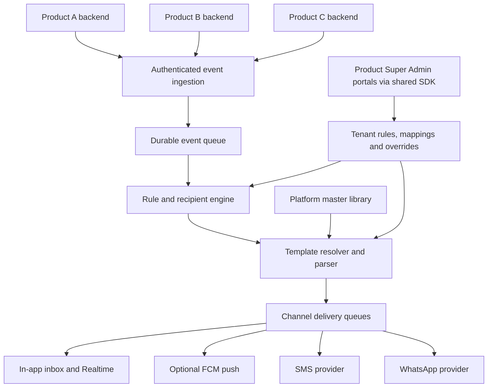

# Common SaaS Notification Engine

## 1. Objective

Build a centralized, multi-product, multi-tenant, backend-agnostic Notification-as-a-Service platform. Supabase is the central engine infrastructure; consuming products may use FastAPI, Supabase, Node.js, Django, .NET or any other backend and database. Flutter is the shared UI integration, not a requirement of the core API. Integrate each SaaS product once and manage notification capabilities centrally without redeploying applications.

| Product | Organization | In-app | SMS | WhatsApp |
|---|---|---|---|---|
| Product A | Org A | Yes | Yes | Yes |
| Product B | Org B | Yes | Yes | No |
| Product C | Org A | Yes | No | No |

The same organization can subscribe to multiple products with different notification configurations. The product name comes from each Flutter application's `config.json`. Super Admin provisions organizations for each SaaS product.

## 2. Architecture

```text
                     Super Admin (Flutter Web)
                  Products / Orgs / Provisioning
                               |
                               v
Product A backend ----> Central Supabase Notification Engine
Product B backend ----> Edge Functions / Authentication
Product C backend ----> Rules / Templates / Channel Resolution
                               |
                       PostgreSQL + Queues
                               |
                     Cron / Delivery Workers
                    /          |           \
               In-app         SMS        WhatsApp
              Realtime     Provider API  Provider API
                    |          |           |
                    |       Delivery logs / Webhooks
                    v
           Common Flutter Notification SDK
             /             |             \
        Product A      Product B      Product C
```

Use one dedicated Supabase project initially. A separate continuously running backend is not required for moderate transactional volumes. Existing product backends remain responsible for business events and user identity.

## 3. Technology stack

| Component | Technology |
|---|---|
| SaaS frontends | Flutter (Web, Android, iOS as applicable) |
| Shared SDK | Dart / Flutter private package |
| Administration | Existing Super Admin portal, Flutter Web |
| Database | Supabase PostgreSQL |
| APIs and adapters | Supabase Edge Functions (TypeScript/Deno) |
| Queue | Supabase Queues (pgmq) |
| Scheduler | Supabase Cron (pg_cron) |
| Live inbox | Supabase Realtime |
| Authorization | Verified JWTs, scoped service credentials, RLS |
| Secrets | Supabase Vault / Edge Function secrets |
| External delivery | SMS provider and WhatsApp Business API |
| Optional push channel | Firebase Cloud Messaging (FCM), APNs transport on iOS |

## 4. Super Admin provisioning

1. Register a product with a unique stable product code.
2. Create or select an existing organization.
3. Assign the organization to the product, creating a product tenant.
4. Apply product channel defaults and customize enabled channels.
5. Configure provider accounts, events and templates.
6. Activate the tenant when provisioning is complete.
7. Audit changes and support suspension or deactivation.

The Super Admin is the source of truth for products, organizations and subscriptions. Do not maintain independently editable duplicate organization masters. If provisioning uses another database, synchronize using a durable, retryable provisioning event and an idempotent endpoint. Track pending/failed provisioning and reconcile periodically.

### Product defaults and effective channels

Product-supported channels are a ceiling; defaults are initial settings, not necessarily permanent restrictions. Example defaults: A = in-app/SMS/WhatsApp; B = in-app/SMS; C = in-app. Adding WhatsApp to C requires expanding its supported capabilities as well as configuring its tenant, rules, provider and approved templates.

```text
Product supported channels
  intersect Tenant enabled channels
  intersect Event configured channels
  intersect Eligible user preferences and consent
  = Effective delivery channels
```

Mandatory notifications may bypass optional preferences only where permitted; they must not bypass applicable consent requirements.

## 5. Data model

Use `product_tenants` as the central isolation boundary. A tenant represents a unique product-organization pair, not an organization alone.

| Table | Main fields / responsibility |
|---|---|
| products | id, product_code (unique), display_name, status |
| organizations | id, organization_code, name, status |
| product_tenants | id, product_id, organization_id, status; unique(product_id, organization_id) |
| channels | code, display_name, status |
| product_channel_defaults | product_id, channel, supported, default_enabled |
| tenant_notification_channels | tenant_id, channel, enabled; unique(tenant_id, channel) |
| notification_events | product_id, event_code, description, payload schema |
| notification_rules | tenant_id, event_id, trigger conditions, recipient strategy, enabled; channels in child table |
| platform_templates / tenant_template_overrides | Global master and tenant-specific field overrides; see section 21 |
| provider_configs | tenant/product scope, channel, provider, secret reference, status |
| product_credentials | product_id, credential hash/reference, scopes, expiry, status |
| user_preferences | tenant_id, external_user_id, event/channel, preferences and consent |
| notifications | id, tenant_id, event_id, recipient, payload, idempotency_key, status, created_at |
| notification_deliveries | id, notification_id, tenant_id, channel, status, provider_message_id, attempt count |
| delivery_attempts | delivery_id, attempt, timestamp, sanitized response/error |
| in_app_notifications | id, tenant_id, external_user_id, notification_id, title, body, action, read_at, created_at |
| audit_logs | actor, tenant/scope, action, timestamp, sanitized changes |

Use UUIDs in implementation; the following IDs are illustrative.

| Tenant | Product | Organization | Status |
|---|---|---|---|
| T001 | product_a | org_a | ACTIVE |
| T002 | product_b | org_b | ACTIVE |
| T003 | product_c | org_a | ACTIVE |

| Tenant | Channel | Enabled |
|---|---|---|
| T001 | IN_APP | true |
| T001 | SMS | true |
| T001 | WHATSAPP | true |
| T002 | IN_APP | true |
| T002 | SMS | true |
| T003 | IN_APP | true |

Enforce foreign keys and tenant-consistent relationships. Index inbox queries on tenant, user and creation time; index pending deliveries and retry times. Use unique constraints for tenant-scoped idempotency keys and one delivery per notification/channel. If the same key is reused with different content, reject the request rather than silently accepting it.

## 6. API design

All endpoints below are proposed interfaces, not existing deployed functions.

### Provision tenant

`POST /functions/v1/provision-tenant` — restricted to authorized provisioning services or Super Admin.

```json
{
  "productCode": "product_a",
  "organizationId": "O001",
  "notificationChannels": {
    "in_app": true,
    "sms": true,
    "whatsapp": true
  }
}
```

Response:

```json
{"tenantId":"T001","productCode":"product_a","organizationId":"O001","status":"ACTIVE"}
```

### Send notification

`POST /functions/v1/send-notification` — authenticated product backend only.

```json
{
  "tenantId": "T001",
  "eventCode": "INVOICE_CREATED",
  "recipient": {"userId":"U001","mobile":"+91XXXXXXXXXX"},
  "data": {"invoiceNumber":"INV001","amount":15000},
  "idempotencyKey":"INV001-created-U001"
}
```

Alternatively resolve the tenant from product code and organization ID. Validate the caller's product identity and tenant access, event schema, recipient and tenant status. The client need not specify channels.

HTTP 202 response after durable acceptance:

```json
{"notificationId":"NOTIF_1001","status":"ACCEPTED","channels":["IN_APP","SMS","WHATSAPP"]}
```

### Other interfaces

| Function / endpoint | Purpose |
|---|---|
| process-notifications | Internal queue worker |
| get-notifications | Paginated user inbox |
| get-unread-count | User unread count |
| mark-as-read | Mark one notification read |
| mark-all-as-read | Mark user's inbox read |
| get-notification-status | Authorized delivery status |
| update-preferences | User preferences |
| provider-webhook | Verified provider delivery callbacks |
| notification-admin | Authorized configuration management |
| resolve-tenant | Resolve active product/organization membership |

## 7. Event rules and templates

| Product / Org | Event | Channels |
|---|---|---|
| A / A | ORDER_CREATED | In-app, WhatsApp |
| A / A | PAYMENT_FAILED | In-app, SMS, WhatsApp |
| A / A | USER_WELCOME | In-app |
| B / B | PAYMENT_FAILED | In-app, SMS |
| C / A | PAYMENT_FAILED | In-app |

Resolve the published platform master template and merge the product-tenant override; no intermediate product-wide template override is planned. Validate required variables, locale and channel-specific restrictions. Store the resolved template version with each delivery.

Example in-app template: `Your order {{orderId}} has been created.`

Example SMS template: `Order {{orderId}} confirmed. Amount: {{amount}}.`

WhatsApp delivery uses approved templates where required and verified consent. SMS providers must support applicable local sender/template registration requirements (including DLT where applicable in India).

## 8. Queues and delivery processing

Create `in_app_queue`, `sms_queue`, `whatsapp_queue` and a dead-letter queue, or use one queue initially with channel routing. Queue messages contain delivery IDs rather than credentials or full sensitive payloads.

```json
{"deliveryId":"DELIVERY_001","notificationId":"NOTIFICATION_001","channel":"WHATSAPP"}
```

1. Authenticate and validate incoming request.
2. Resolve tenant, event, channels and templates.
3. Atomically create notification/delivery records and enqueue jobs using a database function, or use a transactional outbox.
4. Return HTTP 202.
5. Cron invokes bounded Edge Function worker batches. Workers claim messages using queue visibility timeouts.
6. Deliver through channel adapters and persist outcomes before acknowledging jobs.
7. Retry transient errors with exponential backoff and jitter; dead-letter permanent/exhausted failures.
8. Verify provider webhook signatures and deduplicate callbacks. Update delivery state without allowing stale callbacks to regress it.

Suggested delivery states: QUEUED, PROCESSING, SENT, DELIVERED, FAILED, DEAD_LETTERED, CANCELLED. In-app read status is independent of provider delivery status.

Queues may redeliver jobs after failures. Use provider idempotency where available and reconcile ambiguous provider responses; do not promise exactly-once external delivery. Recheck tenant suspension, channel disablement and consent before external delivery. Apply rate limits and per-tenant quotas. Monitor queue age, retries, failures and provider costs.

### Channel adapters

Use Strategy/Adapter interfaces for InAppChannel, SMSChannel and WhatsAppChannel. Each external channel can have multiple provider implementations. Keep provider-specific credentials and API logic server-side. Optional push adapter: Firebase FCM (mobile and web); future adapters may include Email and Webhooks.

## 9. Flutter configuration and shared SDK

Each application has its own `assets/config.json`:

```json
{
  "product_name": "product_a",
  "notification": {
    "enabled": true,
    "api_url": "<central-notification-endpoint>"
  }
}
```

Product B and C use `product_b` and `product_c` respectively. Product name must be stable and match the registered product code. Do not put channels, provider secrets or privileged API keys in this file. The active organization comes from the authenticated session, and channel settings come from Supabase.

### SDK repository structure

```text
notification_sdk/
  lib/
    notification_sdk.dart
    src/
      models/
      services/notification_client.dart
      services/realtime_service.dart
      repositories/
      controllers/
      widgets/notification_bell.dart
      widgets/notification_badge.dart
      widgets/notification_panel.dart
      widgets/notification_tile.dart
      widgets/notification_page.dart
      theme/
  pubspec.yaml
```

### Package distribution — private Git (confirmed)

Publish releases to a dedicated private Git repository, not pub.dev. No package hosting server or separate SDK deployment is required: Flutter fetches the dependency during the build and compiles it into each application. The repository URL below is a placeholder.

Production dependency pinned to a release tag:

```yaml
dependencies:
  notification_sdk:
    git:
      url: git@github.com:your-company/notification-sdk.git
      ref: v1.0.0
```

### Development and release workflow

For local SDK development, use a local path dependency (or a local dependency override):

```yaml
dependencies:
  notification_sdk:
    path: ../notification-sdk
```

Before releasing, update the package version in its `pubspec.yaml`, update the changelog, and run analysis and tests. Commit the release changes, then create and push a version tag:

```bash
flutter analyze
flutter test
git tag -a v1.0.0 -m "Release 1.0.0"
git push origin v1.0.0
```

Use semantic versioning and immutable release tags. Each product independently updates its `ref` and runs `flutter pub get`; commit each application’s `pubspec.lock`. For stronger reproducibility, pin a commit SHA. Do not move published tags.

Developers and CI/CD runners require read access to the private repository. Configure SSH keys or approved Git credentials in the build environment; never embed credentials in `pubspec.yaml`, `config.json`, or Flutter binaries. Set `publish_to: none` in the SDK's `pubspec.yaml` to prevent accidental publication to pub.dev. Private source distribution does not make compiled client code a security boundary.

| Change | SDK release | Product rebuild/redeployment |
|---|---|---|
| Provision organization or enable an existing channel | No | No |
| Update templates, rules or provider configuration | No | No |
| Fix SDK bug or change shared widgets | Yes | Yes, for products adopting the release |
| Add backend-only channel supported by existing client contract | No | No |

The central Supabase backend remains independently deployed. SMS and WhatsApp delivery and credentials stay server-side. Each Flutter product continues to identify itself using `config.json` and its authenticated tenant context.

Illustrative Dart integration (SDK interfaces to be implemented):

```dart
final config = jsonDecode(
  await rootBundle.loadString('assets/config.json'),
);
final notificationClient = NotificationClient(
  productName: config['product_name'],
  enabled: config['notification']['enabled'],
  apiUrl: config['notification']['api_url'],
);
await notificationClient.connect(
  organizationId: currentOrganization.id,
  accessTokenProvider: () async => authService.accessToken,
);
```

```dart
AppBar(actions: [NotificationBell(client: notificationClient)])
```

SDK capabilities: initialize/connect, getNotifications, getUnreadCount, markAsRead, markAllAsRead, subscribe, updatePreferences, switchOrganization and dispose. Clear cached inbox data and unsubscribe on organization switch or logout. Support token refresh, reconnect and inbox resynchronization.

Reusable widgets: NotificationBell, NotificationBadge, NotificationPanel, NotificationPage, NotificationTile, NotificationPreferences and NotificationToast. Allow customization via Flutter themes.

### Navigation

```json
{
  "title":"Payment Received",
  "body":"Payment of ₹5,000 has been received.",
  "action":{"type":"NAVIGATE","route":"/payments/details","params":{"paymentId":"PAY001"}}
}
```

Expose an onNotificationTap callback. Each product validates allowed routes and authorization and performs navigation through its own router.

## 10. Realtime in-app notifications

Store notifications in PostgreSQL and publish authorized changes through Supabase Realtime. Fetch the initial inbox and unread count, then subscribe to updates; resynchronize after reconnect. A subscription filter is not an authorization boundary. Enforce tenant and user scope with RLS or an authorized private broadcast mechanism.

Realtime supports connected applications. Mobile background/closed-app notifications require push infrastructure such as FCM/APNs; push is optional per tenant and subject to device permission.

## 11. Authentication and security

| Caller | Authentication |
|---|---|
| Product backend | Scoped, revocable server-side credential or service JWT |
| Flutter frontend | Verified user token or short-lived exchanged token |
| Super Admin | Authenticated admin identity and server-enforced role |
| Org Admin | End-user access only for notification configuration in the initial release |
| Provider | Verified webhook signature |
| Worker | Internal server-only credential |

`config.json` is public/extractable and is not a trust boundary. Never expose service-role keys or product secrets in Flutter. Validate issuer, audience, expiry and signatures for tokens, plus product/tenant membership. Do not trust user IDs, product codes or tenant IDs merely because they appear in a request.

For separate Supabase projects, use a trusted token exchange or explicitly supported JWT integration; do not assume tokens from another project automatically work with central Realtime or RLS. A central token must be compatible with the central project's verification configuration. If direct Realtime authorization is not ready, use authorized inbox APIs and polling initially.

For a shared Supabase project, reuse trusted auth and membership data where appropriate. For mixed backends, use backend identity adapters/token exchange. RLS must deny cross-tenant access; service-role operations bypass RLS and require explicit server-side authorization. Keep queue/configuration tables private. Restrict read-status updates to allowed fields. Audit privileged changes, redact logs, minimize PII and define retention policies.

## 12. Super Admin portal and permissions

Extend each product’s existing Flutter Web Super Admin portal using the shared admin SDK. Product Super Admins are restricted to their own product and its organizations. Platform master publishing requires a separate platform-level permission (proposed).

```text
Super Admin
  SaaS Products
  Organizations
  Product Subscriptions
  Organization Provisioning
  Notification Management
    Dashboard
    Product Channel Defaults
    Organization Channel Settings
    Provider Management
    Event Management
    Templates
    Notification Rules
    Delivery Logs
    Failed Notifications / Retry
    Usage & Costs
    Audit Logs
```

| Capability | Super Admin | Org Admin | End User |
|---|---|---|---|
| Register products / provision tenants | Yes | No | No |
| Enable channels / suspend tenant | Yes | No | No |
| Configure providers/templates/rules | Yes | No (initial release) | No |
| View delivery logs | Authorized scope | No (initial release) | No |
| Read inbox / preferences | Own or explicitly authorized scope | Own inbox | Own inbox |

Each Product Super Admin is restricted to its own product and organizations. Platform master publishing requires a separate platform-scoped permission (proposed). Super Admin privileges should not automatically imply unrestricted access to private message contents; apply least privilege and audit access.

## 13. Data ownership

| Data | Source of truth |
|---|---|
| Products, organizations, subscriptions | Super Admin |
| Users and business transactions | Respective SaaS product |
| Channel settings, rules, templates | Notification Engine |
| Delivery history, read status, preferences | Notification Engine |

## 14. Project structure

```text
common-notification-platform/
  notification-engine/
    supabase/migrations/
    supabase/functions/
    database-functions/
    channel-adapters/
    tests/
  notification-sdk/
    lib/
    test/
  super-admin/
    notification-management/  # integrate into existing portal
```

## 15. Implementation roadmap

| Phase | Deliverables |
|---|---|
| 1 | Schema, RLS, authentication, product/organization provisioning and channel settings |
| 2 | Common send API, event rules, templates, durable queue/idempotency and in-app inbox |
| 3 | Flutter SDK, reusable widgets, Realtime, organization switching |
| 4 | SMS/WhatsApp adapters, retries, dead-letter queue, verified webhooks, consent and rate limits |
| 5 | Super Admin management UI, monitoring, audit logs, controlled retries and usage tracking |
| 6 | Scheduling, localization, cost allocation, Optional push and advanced preferences (email is out of scope unless approved) |

Implement durable queues, idempotency and authorization before production external messaging. Test cross-tenant access, duplicate requests, provider timeouts, queue redelivery, token expiry, suspension, preference changes and organization switching.

## 16. Scaling strategy

Start with Supabase Edge Functions and bounded Cron-driven workers. Cron cadence and function execution limits affect delivery latency and throughput. Benchmark against expected volume and provider limits. Scale PostgreSQL as needed; move long-running/high-throughput workers to containers or dedicated services if necessary. External queues (SQS/RabbitMQ/Kafka) can be introduced later without changing the Flutter SDK or product integration contract.

## 17. Decisions and open questions

Confirmed requirements: multiple SaaS products, Flutter frontends, product name in `config.json`, Super Admin provisioning organizations for each product, product-organization-specific notification channels, and private Git distribution of the common Flutter SDK (no pub.dev publication).

Proposed decisions: dedicated central Supabase project, globally unique organization identifiers, `product_tenants` isolation, product channel defaults, existing Super Admin portal extension, server-side event triggering and asynchronous delivery.

Still to confirm:
- Do products share one Supabase project, use separate projects, or use different backends?
- How are user identities, organization memberships and admin roles currently managed?
- How do the existing product-specific Super Admin portals provision organizations and synchronize identifiers?
- What are the expected notification volumes and latency requirements?
- Which SMS and WhatsApp providers, sender accounts and consent requirements apply?
- Org Admin configuration is excluded initially; future delegation requires a separate decision.
- Are Flutter Web, Android and iOS all required?

This is a consolidated architecture proposal, not a deployed or tested implementation. Schema, API and SDK examples are illustrative. Supabase plan limits, provider costs and authentication compatibility must be verified before production deployment.

## 18. Reference documentation

- Supabase Queues: https://supabase.com/docs/guides/queues
- Supabase Realtime: https://supabase.com/docs/guides/realtime
- Supabase Edge Functions: https://supabase.com/docs/guides/functions
- Supabase Cron: https://supabase.com/docs/guides/cron
- Supabase RLS: https://supabase.com/docs/guides/database/postgres/row-level-security


---

## 19. Consolidated architecture decisions (earlier revision; see sections 30–45 for latest guidance)

This revision extends and clarifies sections 1–18. Where older illustrative API or schema examples differ, the detailed contracts in sections 19–29 take precedence. All examples remain proposals, not deployed interfaces.

### Confirmed requirements

- Each product has its own Super Admin portal and independently defined workflows, statuses, events, actions and business logic. Both workflow transitions and independent button actions must be supported, including within one module.
- Product Super Admin manages notification design, role-based rules and organization-specific overrides for its own product. No organization-admin configuration in the initial release.
- Platform-wide master templates are provisioned logically to every product and its organizations. An override is scoped to a product-organization pair, never to an organization globally.
- Dynamic variable parsing, mapping and channel-specific rendering are required. The shared Flutter package is distributed via private Git, not pub.dev.

### Recommended architecture and ownership

| Responsibility | Product backend / portal | Central engine | Shared Flutter SDK |
|---|---|---|---|
| Business workflows, actions, transactions | Own and execute | Metadata only | Product UI invokes business APIs |
| Users, roles, memberships | Authoritative | Minimal projection or authorized lookup | Authenticated context |
| Event definitions and values | Define and publish | Register and validate | No trusted event publication |
| Master templates | View | Own and publish | Shared admin UI |
| Rules, mappings, org overrides | Super Admin configures | Store, validate, execute | Shared admin UI |
| Recipient relationships | Supply authorized context | Resolve eligible recipients | Display only |
| Parsing, formatting, delivery | No | Own | Render final content |
| Device permissions and tokens | Host app setup | Token registry and FCM sending | Request permission, refresh tokens |
| Inbox, read state, preferences | Consume | Authoritative | Widgets and API client |



Two private repositories are recommended: `notification-engine` (Supabase migrations, APIs, workers, adapters, tests) and `notification-sdk` (shared Flutter admin and client modules). Existing product repositories retain their event publisher, outbox, identity adapter and business logic. A platform-scoped publishing permission is proposed; no separate portal is required.

## 20. Product event registry and unified triggers

Register product modules, workflow/status metadata, action codes, event definitions, navigation routes and versioned event schemas. Use product-scoped unique event codes. A `notification_events.json` manifest is optional; dynamic products may synchronize metadata via authenticated backend APIs. Never trust Flutter assets as authorization or authoritative registration.

Supported trigger types: `WORKFLOW_TRANSITION`, `STATUS_CHANGE`, `ACTION`, `RECORD_CREATED`, `RECORD_UPDATED`, `ASSIGNMENT`, `SCHEDULED`, `MANUAL`, `SYSTEM_EVENT`. Workflow fields are optional except where required by the trigger schema. A button that changes status should emit one canonical business event unless distinct notifications are intentionally configured.

| Product | Event | Trigger | Example recipient |
|---|---|---|---|
| A | PURCHASE_APPROVED | Workflow transition | Requester, finance |
| A | SEND_VENDOR_REMINDER | Independent action | Authorized vendor |
| B | LEAVE_SANCTIONED | Workflow transition | Employee |
| C | STOCK_RECEIVED | Status change | Warehouse supervisor |

Canonical event example (authenticated product backend only):

```json
{
  "productCode": "product_a",
  "organizationId": "ORG_A",
  "eventCode": "PURCHASE_APPROVED",
  "schemaVersion": 1,
  "triggerType": "WORKFLOW_TRANSITION",
  "moduleCode": "PURCHASE",
  "workflow": {"code":"PURCHASE_APPROVAL","from_status":"SUBMITTED","to_status":"APPROVED"},
  "actionCode": "APPROVE",
  "actorId": "U001",
  "recordId": "PR001",
  "occurredAt": "2026-01-01T10:00:00Z",
  "idempotencyKey": "PR001-transition-005",
  "recipientContext": {"requesterId":"U002"},
  "data": {"purchase":{"number":"PR-1001","amount":25000,"currency":"INR"}}
}
```

For an independent action use `triggerType: ACTION`, `eventCode: SEND_VENDOR_REMINDER`, `actionCode: SEND_REMINDER`, a unique action occurrence ID and relevant data; omit workflow context. Publish only after successful authorized business action. The API returns a durable event receipt (HTTP 202), not a claim that notifications have been delivered or channels resolved.

Rules are tenant scoped: event, optional workflow/from/to/current status and action conditions, recipient strategy, priority, active version and channel/template bindings. Use a restricted typed condition model, not arbitrary SQL. Strategies include specific user, all users in role, assigned user, reporting manager, record owner, initiator, approver and all eligible org users. Business relationships come from the product. Validate tenant membership, contact eligibility and current role where relevant; deduplicate users with multiple roles. Define explicit conflict policy for overlapping rules (recommended: one delivery per event occurrence, recipient, channel and notification intent; deterministic priority and rule ID tie-break).

## 21. Platform templates and tenant overrides

Master templates are generic reusable designs such as `APPROVAL_REQUIRED`, `APPROVAL_SUCCESS`, `REJECTION`, `STATUS_UPDATE`, `REMINDER`, `ASSIGNMENT`, `ACTION_REQUIRED`, `GENERAL`, `WELCOME_USER` and `SYSTEM_ALERT`. Events and roles remain product-specific; a template does not determine who receives it.

- Provision templates by logical inheritance, not physical copies. All tenants see the library; availability for delivery depends on compatible variables, active rules, enabled channels and provider approvals.
- Resolve published master version, channel and locale; merge published tenant override for that master/channel/locale. Product A + Org A changes must not affect Product C + Org A.
- Recommended field-level JSON merge: absent fields inherit, explicit null only where schema permits, nested objects merge, arrays replace. Validate merged output before publication. Reset individual fields or the entire override.
- Allow title, body, supported layout, icon, theme color, action label and channel content overrides. Routing and authorization remain separate. Use safe predefined Flutter components; never download executable UI code.
- Maintain immutable versions and draft/validate/preview/publish/rollback/archive lifecycle. Compatible master changes can propagate after validating affected mappings and overrides; incompatible changes require migration or pinning. Keep previously rendered notifications unchanged.
- A tenant-wide override of a master affects all its bindings within that tenant; if event-specific or role-specific variants are needed, introduce explicit scoped variants with deterministic precedence (decision pending).

Example override:

```json
{"tenant_id":"T001","template_code":"APPROVAL_REQUIRED","channel":"IN_APP","locale":"en","overrides":{"title":"Purchase authorization pending","design":{"color":"#D97706"},"action_label":"Authorize purchase"}}
```

## 22. Dynamic variable engine

Central backend builds a recipient-specific context, resolves mappings, parses templates, formats values and produces final channel payloads. Flutter displays rendered content; it does not parse business variables.

Namespaces: `product`, `organization`, `recipient`, `actor`, `event`, `workflow`, `action`, `data`, `system`, `links`, `vars` (mapped generic variables). Workflow namespace is absent for independent actions. Register JSON Schema versions, variable paths, labels, types, required/default values, sensitivity and allowed channels. Types include strings, integers, decimals, booleans, dates, timestamps, URLs, enums, objects and arrays.

Example master body:

```handlebars
Hello {{recipient.name}},
Your {{vars.record_type}} {{vars.record_reference}} has been approved.
Amount: {{vars.amount | currency:"INR"}}
{{#if data.is_urgent}}Please take immediate action.{{/if}}
```

Example event-to-template mapping:

```json
{"record_type":{"type":"STATIC","value":"Purchase Request"},"record_reference":{"type":"PATH","path":"data.purchase.number"},"amount":{"type":"PATH","path":"data.purchase.amount"}}
```

Product B may map `data.leave.reference` to the same generic reference. Mappings are attached to tenant event/template bindings; required fields must exist for the chosen template. Do not bind an amount-required template to an event without amount unless a valid default or alternate template is configured.

Proposed restricted Mustache-inspired grammar (not standard Mustache): nested paths, bounded array indexing, explicit defaults, currency/date/number formatting, uppercase/lowercase, masking, count, simple boolean conditions and bounded loops. Define exact grammar and null semantics before implementation; use an audited parser or restricted AST, never `eval`, SQL, Dart or arbitrary JS. Deny prototype/property traversal outside registered JSON paths; limit depth, size, loop count and rendering time. Escape for the output context and prevent unsafe URLs. Use locale and timezone-aware formatting.

Unknown variables/formatters block publication. Missing required runtime values fail rendering; optional values use explicit defaults. Never send unresolved placeholders. Record sanitized rendering errors separately from provider failures. Minimize sensitive payloads; restrict lock-screen content and redact logs. WhatsApp and applicable SMS DLT templates use approved provider parameter mappings; overrides may need renewed approval.

The common admin designer includes event-specific variable picker, static/path mapping editor, schema validation, sample payload, channel previews, override indicators and version history. Preview and delivery use the same backend parser. Preview must not send messages or expose another tenant's data.

## 23. Revised logical schema and API contracts

Names below are proposed canonical names; consolidate earlier illustrative names rather than create duplicate tables.

| Scope | Tables / entities |
|---|---|
| Platform | platform_templates, platform_template_versions, platform_template_channels, platform_template_variables, platform_design_components |
| Product | products, product_modules, product_workflows, product_workflow_statuses, product_actions, product_events, product_event_schemas, product_event_variables, product_navigation_routes |
| Tenant | organizations, product_tenants, tenant_roles, tenant_user_roles, tenant_notification_channels, notification_rules, notification_rule_channels, tenant_template_variable_mappings, tenant_template_overrides, tenant_template_override_versions, tenant_provider_configs |
| Runtime | notification_event_logs, notifications, notification_recipients, notification_deliveries, delivery_attempts, in_app_notifications, device_tokens, user_notification_preferences, user_notification_consents, template_render_logs, audit_logs |
| Operations | usage_metering, dead_letter_records, scheduled_jobs, provider_webhook_events |

Use tenant-consistent composite foreign keys, unique product/event code, unique product/org pair, unique event idempotency key per tenant, unique active override per tenant/master/channel/locale and unique delivery intent. Immutable versions retain master/override/rule/schema IDs. Keep role and user projections minimal and track source version, active state and synchronization time.

Proposed Edge Function interfaces: `register-product`, `provision-tenant`, `sync-metadata`, `sync-roles`, `sync-users`, `publish-event`, `validate-template`, `preview-template`, `publish-template`, `manage-rules`, `manage-overrides`, `get-notifications`, `mark-as-read`, `register-device`, `revoke-device`, `update-preferences`, `provider-webhook`, `process-notifications`. Existing `send-notification` example is a compatibility façade if needed; canonical integration is event publication. Version API and schema contracts independently of SDK releases.

## 24. Firebase push and permissions

Recommended hybrid: Supabase remains the source of truth for authentication integration, notification records, configuration, queues and delivery logs. FCM HTTP v1 is only the push transport; no Firebase database or Firebase Auth requirement. APNs configuration is required for iOS. Decide Firebase project/app separation per product and environment before deployment; prefer isolation for independent production apps where operationally appropriate.

- Host Flutter app configures Firebase, platform app registrations, Android/iOS capabilities and web HTTPS/service worker/VAPID where applicable. SDK handles token registration, refresh, foreground/background behavior and permission UX.
- Store device token with tenant/user/product/app/environment scope, platform, permission state, last seen and revocation status. Secure tokens and credentials; handle invalid tokens and logout/org switch without leaking notifications across accounts. Revalidate membership on delivery.
- Push is optional; existing A/B/C channel matrix does not imply push enabled. Prompt only when enabled and useful, with user gesture where required. Android 13+ and iOS/web require appropriate OS/browser permissions. Denial must not block in-app inbox; avoid repeated prompts.
- In-app needs no OS permission. SMS/WhatsApp require applicable consent and provider eligibility, not device permission. Apply product support, tenant enablement, rule selection, preferences, consent and device eligibility. Mandatory classifications never override legal consent or OS permission.
- FCM acceptance is not proof of device delivery or reading. Avoid sensitive lock-screen content; deep links must be validated by the host product and reauthorized on open.

## 25. Security and identity architecture gaps

Production blockers: existing auth topology, issuer trust, token exchange and role synchronization strategy are not yet known. Use scoped backend credentials with rotation/revocation and short-lived user/admin tokens. Validate issuer, signature, audience, expiry, product, tenant membership and permissions. Never authorize using `config.json` alone. Identity keys include product/tenant and external user ID. Central Realtime tokens must be compatible with its verification model; otherwise use authorized polling/API initially.

Separate platform publisher, product admin, end user, service publisher and worker privileges. Enforce RLS plus explicit authorization for service-role paths. Protect private queues and provider secrets, verify webhook signatures and replay resistance, rate-limit endpoints and audit administrative actions. Define membership revocation propagation and fail closed for stale sensitive authorization. Test tenant isolation for every API, cache, subscription, export and background job. Define privacy retention, data residency, deletion and access requests before production.

## 26. Reliability, queues and delivery lifecycle

- Product transactional outbox: commit business change and event row together; publisher retries independently. Central ingestion atomically persists event and queue job before returning 202. Repeated identical keys return existing receipt; mismatched payloads conflict. No distributed transaction between products and central engine.
- At-least-once processing: idempotent rule expansion, recipient deduplication and unique delivery intents. Persist rendered content and selected versions before sending. Use provider idempotency where supported; ambiguous provider timeouts require reconciliation rather than blind retry. Exactly-once external delivery cannot be guaranteed universally.
- Separate event processing and channel delivery queues, with bounded batches, visibility leases, recovery of expired leases and per-tenant fairness. Use exponential backoff with jitter, provider Retry-After, max attempts and expiry. Permanent failures go to dead-letter records; audited replay must preserve intent IDs and recheck current eligibility.
- Distinguish event acceptance, rendering failure, queued, processing, provider accepted, delivered (only if verified), failed, expired, suppressed and unknown. Read state is separate. Verify and deduplicate webhook events; handle out-of-order status updates without regressing terminal state.
- Define ordering only where business requirements demand it (e.g., per record sequence); avoid global ordering. Record event occurrence time and sequence if supplied. Scheduled sends recheck current consent, tenant state and expiry before delivery.
- Provider adapters expose send, normalize error, verify webhook and reconcile capabilities. Use per-tenant sender configuration and secret references; never silently switch sender/provider if consent or approved templates differ.

## 27. Additional architecture gaps and recommended policies

| Item | Proposed design / decision needed | Priority |
|---|---|---|
| Priority and throttling | Priority lanes, per-tenant/channel quotas, provider limits, fair scheduling and backpressure | Production baseline |
| Scheduling and quiet hours | UTC storage, IANA timezone, daylight-saving handling, defer optional notifications, expiry | Phase 2 unless required |
| Grouping and digests | Group key, time window, unread count semantics; retain individual audit records | Phase 2 |
| Escalation and fallback | Explicit timed rules, consent checks, stop conditions and deduplication; business escalation remains product-owned | Phase 2 |
| Localization | BCP 47 locale, tenant default, explicit fallback, versioned translations and channel approval | Baseline schema; rollout as needed |
| Retention and expiry | Per-class retention, TTL, purge/anonymization, legal hold, backup policy | Production baseline |
| Monitoring | Queue age/depth, acceptance-to-delivery latency, failures, retry rates, webhook lag, rendering errors, token health | Production baseline |
| Cost and metering | Tenant/channel usage, SMS segments, provider charges, quotas, budget alerts and reconciliation | Before paid channels |
| Disaster recovery | Backup/PITR availability, restore drills, RPO/RTO targets, queue reconciliation and secret recovery | Production baseline |
| Environments | Separate dev/staging/prod Supabase, Firebase and provider credentials; synthetic test data | Production baseline |
| Deployment | CI/CD, migration review, backward-compatible API changes, staged rollout, rollback and immutable Git tags | Production baseline |
| Testing | Parser/schema unit tests, API contract tests, RLS isolation, queue crash/retry tests, provider sandbox, Flutter lifecycle and load tests | Production baseline |
| Service objectives | Define volume, burst rate, latency percentiles, availability and recovery targets; benchmark before sizing | Pending input |

Operational dashboard should expose sanitized correlation IDs, queue backlog, tenant/channel health and audited replay controls. Alert on sustained queue lag, failure spikes, provider outages and abnormal usage. Do not log full tokens, secrets or unrestricted event payloads. Define incident ownership and runbooks. Use circuit breakers and bounded concurrency; move workers beyond Edge Functions if measured workload exceeds execution or throughput limits.

## 28. Updated implementation roadmap and acceptance criteria

1. Finalize identity, tenant provisioning, event contract, environment isolation and threat model. Implement schema, RLS, scoped APIs and audit baseline.
2. Build product metadata registry, outbox integration, durable event ingestion, rule matching and recipient resolution. Test workflow and independent action events and duplicate ingestion.
3. Implement master library, versioned overrides, variable mapping, restricted parser, channel rendering and shared Super Admin designer with preview/publish/reset. Verify Product A/Org A override does not affect Product C/Org A.
4. Deliver in-app inbox, Realtime or authorized polling, read state, preferences, shared private-Git Flutter SDK and navigation. Verify logout and tenant switching.
5. Add SMS/WhatsApp provider adapters and optional FCM, permission UX, consent, delivery webhooks, retries, dead-letter replay, usage and quotas. Confirm approved provider templates and sender identities.
6. Complete load/security testing, dashboards, alerts, retention, backup/restore drills and production rollout. Add advanced scheduling, digests, escalation and fallback based on approved scope.

Release gates: no cross-tenant access; durable acceptance under outages; deterministic deduplication; no unresolved placeholders; valid role and channel eligibility; correct template inheritance; verified callbacks; safe navigation; no client secrets; recoverable failures; tested rollback and restore. Test missing variables, incompatible schema changes, stale roles, denied permissions, invalid tokens, concurrent workers, provider timeouts and out-of-order webhooks.

## 29. Outstanding decisions and limitations

Confirmed requirements are listed in section 19. Recommendations not yet explicitly approved: dedicated Supabase topology, two repositories, separate platform publishing permission, field-level override semantics, restricted template grammar, JSON Schema, transactional outbox, role projection versus lookup, optional FCM architecture and advanced delivery policies.

Before implementation confirm actual product backend/auth topology, identity and organization IDs, role synchronization SLA, provider choices and sender accounts, push-enabled tenants and target Flutter platforms, Firebase project layout, event volumes and latency, retention/data residency, RPO/RTO, notification classifications, locale requirements, event/role-specific override variants, escalation policies and budget. No live provider, database, SDK, deployment or load tests have been performed. The document is an architecture proposal; exact SQL migrations and API specifications remain implementation deliverables.

Additional reference: Firebase Cloud Messaging — https://firebase.google.com/docs/cloud-messaging

## 30. Consolidated architecture decisions and responsibility boundaries

This section and sections 31–37 refine the earlier baseline; where an earlier illustrative schema, API or roadmap differs, use these later decisions. No implementation has been deployed or tested.

Confirmed requirements: every product has its own events, workflows, statuses and actions; workflows are optional and independent button actions are supported. Platform master templates are provisioned for every product and organization through logical inheritance. Product Super Admins manage notification rules, roles and organization-specific template designs. Overrides apply only to the selected product-organization pair. Dynamic variable parsing is required. Org Admins do not manage notification configuration initially. Flutter SDK distribution remains private Git.

| Component | Product backend | Central notification engine |
|---|---|---|
| Business workflows, status changes, button actions | Executes and authorizes | Metadata only |
| Events and payload schemas | Defines, registers and publishes | Validates and processes |
| Users, roles and assignments | Authoritative source | Scoped projection or authorized lookup |
| Business relationships (manager, owner, approver) | Resolves or supplies authorized references | Uses references in recipient rules |
| Organization provisioning | Initiates | Idempotently registers product tenant |
| Templates, overrides, mappings, rules | Super Admin configures via shared UI | Stores, versions and evaluates |
| Dynamic variables and channel rendering | Supplies permitted values | Resolves, validates and renders |
| Outbox | Durable business-event publication | Durable ingestion and delivery queues |
| Provider integration, consent, delivery history | App permissions and business context | Enforces eligibility and delivers |

Recommended repository split: `notification-engine` (Supabase migrations, Edge Functions, workers, tests) and `notification-flutter-sdk` (shared admin/client modules, API client, permission handling), both private Git. Each product integrates the SDK and a lightweight backend publisher. Existing product admin portals host the shared UI; no separate central product administration portal is required. A platform-level master publishing permission is proposed; its UI location remains open.

## 31. Product metadata, event contract and expanded schema

Register product-scoped modules, events, workflow metadata, statuses, actions, navigation routes and versioned event schemas. A backend-synchronized `notification_events.json` manifest is optional; dynamic workflows may register through authenticated APIs. Never trust Flutter configuration for authorization. Event codes are unique within a product, not globally. Support WORKFLOW_TRANSITION, STATUS_CHANGE, ACTION, RECORD_CREATED, RECORD_UPDATED, ASSIGNMENT, SCHEDULED, MANUAL and SYSTEM_EVENT. Workflow/status/action fields are optional or required according to the registered trigger schema. A button that also changes status should publish one canonical event unless distinct business purposes require separate events.

```json
{
  "productCode": "product_a",
  "organizationId": "ORG_A",
  "eventCode": "PURCHASE_APPROVED",
  "schemaVersion": 1,
  "triggerType": "WORKFLOW_TRANSITION",
  "moduleCode": "PURCHASE",
  "workflow": {"code": "PURCHASE_APPROVAL", "from_status": "SUBMITTED", "to_status": "APPROVED"},
  "actionCode": "APPROVE",
  "recordId": "PR001",
  "actorId": "USER001",
  "idempotencyKey": "PR001-transition-005",
  "data": {"purchase": {"number": "PR-1001", "amount": 25000, "currency": "INR"}}
}
```

An independent action uses `triggerType: ACTION`, e.g. `eventCode: REMINDER_REQUESTED`, `actionCode: SEND_REMINDER`, with no workflow object and a unique action execution ID. Publish only after authorization and successful business execution. Use `POST /events/publish`, authenticated metadata sync, tenant provisioning, role/user sync, template preview/validation, rule configuration, inbox and device registration APIs. Return 202 only after durable acceptance. Product identity must come from trusted credentials, not the request body alone.

Expanded logical tables (final migration names to be standardized):

| Scope | Tables / responsibilities |
|---|---|
| Platform | platform_templates, platform_template_versions, platform_template_channels, platform_template_variables, platform_design_components |
| Product | products, product_modules, product_workflows, product_workflow_statuses, product_actions, product_events, product_event_schemas, product_event_variables, product_navigation_routes |
| Tenant | organizations, product_tenants, tenant_roles, tenant_user_roles, tenant_notification_channels, tenant_notification_rules, tenant_rule_channels, tenant_template_variable_mappings, tenant_template_overrides, tenant_template_override_versions, tenant_provider_configs |
| Runtime | notification_event_logs, notifications, notification_recipients, notification_deliveries, delivery_attempts, in_app_notifications, device_tokens, user_notification_preferences, user_notification_consents, template_render_logs, audit_logs |
| Operations | scheduled_jobs, dead_letter_jobs, provider_callback_receipts, usage_meters, configuration_releases |

Use tenant-consistent foreign keys, unique product/event codes, versioned rules, indexed recipient memberships and inbox pagination. Keep product business records outside the central database. Define role projection freshness, revocation and reconciliation; fail closed when authorization cannot be established.

## 32. Master templates, overrides and role-based rules

Generic platform templates (APPROVAL_REQUIRED, APPROVAL_SUCCESS, REJECTION, STATUS_UPDATE, REMINDER, ASSIGNMENT, RECORD_CREATED, ACTION_REQUIRED, GENERAL) are reusable across unrelated products. Inheritance makes templates available without copying rows or activating rules/channels. Product Super Admin selects tenant, product event, optional workflow/status/action conditions, recipient strategy/role, channel, template and variable mapping. A rule may select different templates for different roles and channels.

Recommended override model: field-level JSONB patches against a published master, scoped by tenant, master template, channel and locale. Store base version, override version, status, author and timestamps; enforce one active published override per scope. Allow title, body, approved layout/icon/color, action label and channel content customization. Reset removes the active override. Compatible master updates flow through unchanged fields; breaking updates require validation and migration. Preserve immutable rendered snapshots and resolved versions for historical messages. No product-wide override layer is assumed. If two rules need different custom designs for the same master in one tenant, use distinct template variants or an explicit rule-scoped variant key (proposed).

Recipient strategies: SPECIFIC_USER, ALL_USERS_IN_ROLE, ASSIGNED_USER, REPORTING_MANAGER, RECORD_OWNER, EVENT_INITIATOR, APPROVER, ALL_ORG_USERS. Resolve business relationships in the product; validate membership centrally. Deduplicate overlapping roles by recipient and notification purpose; distinct intentional messages remain possible. Template inheritance never grants access or enables delivery. Navigation actions use registered routes and the product rechecks authorization when opened.

## 33. Dynamic variable parser and template designer

Central backend owns a restricted Mustache-inspired language, not arbitrary code. Build recipient-specific context from approved namespaces: `product`, `organization`, `recipient`, `actor`, `event`, `workflow`, `action`, `data`, `system`, `links`, `vars`. Product event JSON Schema defines types, required fields, allowed paths, sensitivity and sample values. Map generic template variables to static values or registered JSON paths, e.g. `vars.record_reference` -> `data.purchase.number`; another product can map to `data.leave.reference`.

```text
Hello {{recipient.name}},
Your {{vars.record_type}} {{vars.record_reference}} has been approved.
Amount: {{data.purchase.amount | currency:"INR"}}
```

Proposed syntax supports nested paths, bounded array indexing, defaults, uppercase/lowercase, locale-aware currency/date/number formatting, masking, count, restricted if/each blocks. These extensions are not standard Mustache; select or implement a safe parser with a documented grammar. No eval, arbitrary SQL/JS/Dart, prototype traversal or unbounded loops. Limit payload size, depth, output length and execution time. Escape by output context; allowlist links and design components. Reject unknown variables/formatters at publication, fail rendering for missing required values, use explicit defaults for optional values, and never deliver unresolved placeholders. Block or mask sensitive fields per channel. Render separately per recipient; minimize retained payloads and redact errors.

Admin UI: event-specific variable picker, typed sample payload editor, mapping editor, role/channel/locale selection, inherited versus overridden fields, live preview, validation, publish and reset. Preview and worker share the same server-side parser. Flutter consumes rendered content and safe design JSON only. WhatsApp and applicable SMS DLT use approved provider template parameters; overrides may require reapproval. No arbitrary dynamic content in approved fixed portions.

## 34. Firebase push and permissions

Recommended hybrid: Supabase remains the source of truth; Firebase Cloud Messaging is only a push transport, not a replacement for database/auth/rules. Push is optional per product and tenant; existing A/B/C channel matrix remains unchanged until enabled. Use server-side FCM HTTP v1 credentials, scoped provider configuration and device token records keyed by product, tenant, user and installation. Register/rotate tokens, revoke associations on logout/org switch, remove invalid tokens and avoid sensitive lock-screen content. Decide Firebase project separation by product/environment and credential isolation before rollout.

Effective delivery requires product support, tenant enablement, active rule, authorized recipient, preferences/consent, valid provider configuration and device permission/token where relevant. Android 13+ runtime permission, iOS authorization/APNs setup, and web HTTPS/service worker/VAPID setup belong in host apps with shared SDK assistance. Ask in context only when enabled; respect denial and avoid repeated prompts. In-app does not require OS notification permission. SMS/WhatsApp consent and opt-out are enforced independently. FCM acceptance is not proof of device delivery or reading. Use the SDK for inbox, unread counts, Realtime, permission state and authorized navigation; clear subscriptions and local state on logout/tenant switch.

## 35. Reliability, scheduling and delivery policies

- Transactional outbox: commit business update and event together in product DB; publisher retries until central durable acceptance. Central ingestion atomically stores event and queue job. A notification outage must not roll back committed business actions.
- Idempotency: unique product/tenant/event occurrence key with payload hash; reject conflicting reuse. Rule execution keyed by event and rule version; recipient dedup by event/purpose/user; delivery keyed by notification/recipient/channel (and intentional delivery occurrence); callback dedup by provider/account/event ID. At-least-once processing, not guaranteed exactly-once external delivery.
- Queues: separate event processing and channel workers (in-app, push, SMS, WhatsApp). Use bounded batches, visibility leases, durable state before acknowledgment, exponential backoff with jitter, provider Retry-After, permanent-error classification and DLQ. Example retry delays: 30s, 2m, 10m, 30m, 2h; tune per provider and expiry. Authorized replay preserves idempotency and rechecks eligibility. Reconcile ambiguous provider timeouts before resending when possible.
- Lifecycle: distinguish RECEIVED/VALIDATED/RENDER_FAILED event states; QUEUED/PROCESSING/ACCEPTED/DELIVERED/FAILED/UNKNOWN/DEAD_LETTERED/CANCELLED/EXPIRED delivery states; UNREAD/READ/DISMISSED/ACTIONED/ARCHIVED interaction states. Do not infer delivery from provider acceptance. Verify callbacks and prevent stale state regression.
- Priority: critical/high/normal/low; digest is a batching policy. Apply fairness across tenants, reserved capacity and starvation protection. Critical priority never bypasses mandatory consent.
- Scheduling: immediate, delayed, scheduled, recurring, relative due-date, reminders, escalation and digests. Persist schedules; Cron claims due work. Use tenant/user time zones, daylight-saving handling, quiet hours and expiry. Revalidate current business status with product before conditional reminders/escalations; cancel obsolete jobs. Define schedule occurrence keys and catch-up behavior.
- Grouping and throttling: configurable grouping by tenant, recipient, purpose/event, record and time window; enforce per-user frequency, tenant quota, provider limits and repeated-click protection. Define whether grouped items remain individually actionable.
- Channel strategy: ALL, PREFERRED, FALLBACK, SEQUENTIAL, ESCALATION, IN_APP_ONLY. Define qualifying failure, timeout, ordering and stop conditions. Avoid fallback on ambiguous acceptance without explicit policy. Recheck consent, tenant state, channel configuration and recipient eligibility immediately before delivery.
- Provider adapters: normalized send/result/error/webhook contract, per-account secrets, rate limits, circuit breakers and health monitoring. Provider failover only when approved sender/template and consent are compatible.

## 36. Remaining production architecture requirements

The following are proposed additions to close the architecture gaps, not confirmed implementation choices.

| Area | Recommended design |
|---|---|
| Cross-product identity | Trusted issuer validation or short-lived token exchange; distinguish platform admin, product admin, user, service and worker; scoped identities, RLS, credential rotation and revocation; no service keys in Flutter |
| Configuration lifecycle | Draft, validate, preview, publish, retire; immutable versions, atomic release, rollback, optimistic concurrency and audit trail; pin rule/template/schema versions for deterministic retries; recheck live permissions |
| Localization | Recipient locale, tenant default, platform fallback; channel-specific translations, locale-aware formats and RTL support; validate required variables across translations |
| Retention and privacy | Separate event payload, inbox, delivery and audit retention; deletion/export workflows, PII minimization, redaction, encryption and tenant offboarding; expiry suppresses stale deliveries |
| Observability | Correlation IDs across product outbox, event, rule, recipient and provider; queue age/depth, render errors, latency, failure rates, DLQ, callback lag, token invalidation; alert thresholds and runbooks |
| Usage and costs | Per-tenant/channel/provider usage ledger, SMS segments, estimated versus billed costs, quotas and budget alerts; reconcile provider invoices; avoid logging sensitive content |
| Capacity and isolation | Load-test fan-out, queue throughput and Realtime; per-tenant fairness and backpressure; partition/archive large runtime tables as needed; move workers outside Edge Functions if limits require |
| Disaster recovery | Define RPO/RTO, backups/PITR availability, restore drills, queue reconciliation, secret recovery and provider outage procedures; central service is a shared failure domain |
| Environments and CI/CD | Separate dev/staging/prod Supabase and provider credentials; versioned migrations, compatibility checks, staged SDK releases, rollback, test recipients/sandbox providers; no production PII in lower environments |
| Testing | Unit parser/rules, schema contract tests, RLS cross-tenant tests, role revocation, outbox and queue crash/replay tests, provider mocks/webhooks, permission tests, localization, load and recovery tests |
| API evolution | Version event contracts and APIs; backward-compatible schema changes, deprecation windows, SDK compatibility matrix and product onboarding checklist |
| Operational access | Least-privilege support tools, scoped replay/cancel, audit privileged reads, incident ownership and tenant suspension/offboarding procedures |

## 37. Revised delivery roadmap and outstanding decisions

| Phase | Deliverables |
|---|---|
| 0 | Confirm identity topology, tenant ownership, provider accounts, target platforms, traffic/SLOs, retention and recovery targets |
| 1 | Central schema/RLS, provisioning, trusted auth, product metadata registry, outbox/ingestion contract and durable queues |
| 2 | Master library, versioned tenant overrides, rule/role resolution, schema validation, dynamic parser, preview and in-app delivery |
| 3 | Shared private Git Flutter admin/client SDK, inbox/Realtime, permission handling, product integration and isolation tests |
| 4 | SMS/WhatsApp and optional FCM adapters, consent, callbacks, retries/DLQ, throttling, monitoring and usage metering |
| 5 | Scheduling, quiet hours, grouping, fallback/escalation, localization, configuration rollback, load and recovery testing |

Open decisions: actual product authentication and database topology; authoritative organization ID mapping; user/role sync versus live lookup and revocation SLA; platform master publishing owner/UI; parser library/grammar; provider selection and account ownership; Firebase project topology and enabled tenants; target platforms; throughput/latency/SLOs; data residency, retention, RPO/RTO and budget. The two-repository split, field-level overrides, logical inheritance, queue topology and advanced delivery policies are recommendations. Validate current Supabase/Firebase/provider limits and regulatory requirements before production. This document is an architecture specification, not evidence of a working system.


## 38. Backend-agnostic architecture and integration boundary

**Confirmed direction:** the central engine must support Flutter + FastAPI as well as Flutter + Supabase and other backend stacks. Products retain their own databases, authentication, workflows and business logic. Supabase is an internal engine implementation, not a required product dependency. The following integration contract supersedes conflicting earlier illustrative endpoints or SDK assumptions.

```text
Flutter host app (shared admin/client SDK)
  | scoped user/admin token + HTTPS API / authorized realtime
  v
Central notification API v1 <--- authenticated product backend / outbox
  |                              FastAPI / Supabase / Node.js / other
  v
Central Supabase: registry, rules, templates, parser, queues, delivery
  |--> In-app / FCM / SMS / WhatsApp
```

Products must not directly write central notification tables or use central service-role keys. The public integration boundary is versioned HTTPS REST with OpenAPI and JSON Schema; realtime is an optional transport with polling/reconciliation fallback. Non-Flutter clients can use the same API with their own UI integration. No product-specific business logic or database driver belongs in the central engine.

## 39. Product integration contract and onboarding responsibilities

| Integration | Requirement | Owner |
|---|---|---|
| Stable product code, API URL/version | Mandatory | Host app/backend |
| Product registration and tenant provisioning | Mandatory | Product backend + platform |
| Trusted service and user/admin identity | Mandatory | Product identity adapter |
| User/role membership sync or authorized lookup | Mandatory for recipient eligibility | Product backend |
| Event registry and versioned variable schemas | Mandatory | Product backend |
| Workflow/status/action metadata | When applicable | Product backend |
| Event publisher after successful business action | Mandatory | Product backend |
| Transactional outbox or equivalent durable publication | Required for reliable events | Product backend |
| Business recipient context | When rule needs owner/manager/approver etc. | Product backend |
| Condition revalidation | When state-dependent reminders/escalations enabled | Product backend |
| Shared Flutter admin/client module | For Flutter products | Host app |
| Navigation handler and route registration | When actionable notifications enabled | Host app/backend |
| FCM app setup and OS permission integration | Only when push enabled | Host app |
| Lifecycle hooks, health checks, acceptance tests | Mandatory | Product integration owner |

Public Flutter config example (no secrets):

```json
{"product_name":"product_b","notification":{"enabled":true,"api_url":"<notification-api-url>","api_version":"v1"}}
```

The host supplies an access-token callback, selected tenant, locale and authorized navigation callback to the shared SDK. Initialize after login; dispose subscriptions, cached inbox and device associations on logout or tenant switch. The SDK must not assume Supabase Auth. Admin screens remain in each product portal; all notification configuration is stored centrally. Product templates, parser, delivery queues and provider integrations must not be duplicated locally.

## 40. API-first contracts and authentication adapters

Proposed canonical endpoints (finalize in OpenAPI before implementation):

| Method/path (under /v1) | Purpose |
|---|---|
| POST /products/register | Platform-authorized onboarding |
| POST /tenants/provision | Idempotent tenant registration |
| POST /metadata/sync | Versioned events, schemas, routes and workflow metadata |
| POST /roles/sync, POST /users/sync | Scoped identity projections and membership updates |
| POST /auth/exchange | Exchange verified product identity for short-lived scoped token |
| POST /events/publish | Durable event acceptance |
| GET /templates, POST /templates/preview | Master library and server-side preview |
| POST /templates/override, POST /rules | Tenant-scoped configuration |
| GET /notifications, POST /notifications/mark-read | Recipient-scoped inbox |
| POST /devices/register | Scoped installation registration |
| GET /health | Non-sensitive service readiness |

Use consistent error envelopes, correlation IDs, pagination, request size limits, rate limits and schema versions. Return 202 only after durable ingestion; identical idempotency retries return the original acceptance reference; conflicting payload reuse returns 409. Retry transient 429/5xx/network errors with jitter and Retry-After; do not blindly retry permanent validation/auth errors. Contract tests must run against both Python and TypeScript clients.

Separate machine credentials from user/admin credentials. Support trusted JWT issuers (including Supabase Auth and FastAPI custom JWT/OIDC) or authenticated backend token exchange. Verify signature, issuer, audience, expiry, tenant membership and permissions; derive product scope from credentials, not config.json or body fields. Namespace external user IDs by product/issuer and tenant membership. Use short-lived scoped tokens, credential rotation and revocation. If realtime is used, issue credentials compatible with central Realtime authorization and RLS; otherwise use the API polling fallback. Exact token exchange and revocation SLA remain open.

## 41. Common backend SDKs and FastAPI integration

Recommended private Git components: `notification-engine`, `notification-flutter-sdk`, `notification-python-sdk` (FastAPI/Django/Flask), `notification-typescript-sdk` (Supabase/Node.js). Keep OpenAPI, JSON Schemas, onboarding guide and reusable contract tests in the engine repository initially; split only if release ownership warrants it. SDKs are lightweight API wrappers, not separate engines. Pin immutable release tags/commits and publish compatibility matrices. Other languages can use generated clients or plain REST.

Python SDK responsibilities: async HTTP client, service authentication, provisioning, metadata and membership sync, event publishing, idempotency headers, bounded retries, typed errors and correlation IDs. Product-specific transaction/outbox and business adapters remain in the host. Example proposed interface (not implemented):

```python
from notification_sdk import NotificationClient

client = NotificationClient(base_url=settings.NOTIFICATION_API_URL,
                            product_code=settings.PRODUCT_CODE,
                            credential_provider=get_service_credential)
# Called by durable outbox worker, not before business commit.
await client.publish_event(organization_id="ORG_B",
    event_code="INVOICE_APPROVED", schema_version=1,
    trigger_type="WORKFLOW_TRANSITION",
    workflow={"code":"INVOICE_APPROVAL","from_status":"PENDING","to_status":"APPROVED"},
    data={"invoice_number":"INV-1001","amount":25000},
    idempotency_key="invoice-1001-transition-01")
```

FastAPI suggested layout: `notification_integration/{config,client,identity_adapter,metadata_registry,lifecycle_hooks,event_publisher,recipient_context,condition_validator,outbox_worker,health_check}.py`. Flutter host layout: `notification_integration/{initialization,identity_adapter,navigation_handler}.dart`. These are suggested adapters, not mandatory filenames. Use the same event contract for TypeScript products. Keep service credentials in backend secret storage only.

## 42. Product lifecycle hooks and business context

| Product lifecycle change | Required notification behavior |
|---|---|
| Organization create/reactivate/suspend/delete | Provision/reactivate/suspend/offboard tenant; stop pending sends on suspension |
| User create/update/deactivate/delete | Update scoped identity/contact references; revoke eligibility/access; apply retention policy |
| Role create/update/delete or membership change | Sync versioned membership; invalidate affected rules; revoke access promptly |
| Workflow/status/action/event changes | Register versioned metadata; validate affected rules and schemas |
| Login/logout/tenant switch | Initialize or clear SDK session, cache, subscriptions and device associations |
| Locale/contact changes | Update locale and verified eligible endpoints; recheck consent |
| Business action succeeds | Commit event with business change; publish via durable worker |

Use versioned synchronization, tombstones, reconciliation and freshness limits; live lookup may replace projections if equivalent authorization/revocation guarantees are met. Product remains source of truth. Do not send if membership or eligibility cannot be established.

Business-specific recipients are supplied as authorized user references, e.g. `recipientContext: {"record_owner":["USER001"],"assigned_approver":["USER002"]}`. The engine resolves role-based recipients and validates all supplied references against tenant membership and current eligibility. Products must not use arbitrary recipient addresses to bypass rules.

For state-dependent scheduled work, register an authenticated product condition endpoint with allowlisted condition codes and record references. Return eligible/ineligible/temporarily unavailable; fail closed on unavailable and retry within expiry. Never allow templates to execute arbitrary product queries or call arbitrary URLs. Navigation uses registered route codes and validated parameters; the host independently authorizes record access.

## 43. Product database footprint and durable event publication

No local notification templates, rules, inbox, delivery history or provider credentials are required. Product DB owns business records, users, roles, workflows and authoritative event definitions. Add a transactional outbox or equivalent durable change-stream mechanism for reliable events. Suggested outbox fields: id, organization_id, event_code, schema_version, payload, idempotency_key, status, attempt_count, next_retry_at, lease_until, last_error, created_at, published_at. Commit the outbox entry atomically with the business change using the product database's supported transaction mechanism. If atomic transactions are unavailable, design and test an equivalent reliable capture mechanism before claiming guaranteed publication. Worker claims records safely, retries with stable keys, marks published only after durable central acceptance, and alerts on backlog/poison events. Minimize payload PII and apply retention.

## 44. Product onboarding and acceptance checklist

- [ ] Register stable product code and environment-specific endpoint; install pinned Flutter SDK and backend SDK/REST client.
- [ ] Configure service credentials and scoped user/admin identity adapter; verify token expiry and revocation.
- [ ] Integrate organization lifecycle, user/role sync or lookup, and reconciliation.
- [ ] Register modules, events, versioned variable schemas, optional workflows/statuses/actions, recipient context and navigation routes.
- [ ] Integrate event publication and durable outbox; verify successful business commit survives central outage.
- [ ] Mount shared Super Admin UI, inbox, unread badge and navigation; test login/logout/tenant switch.
- [ ] Configure optional FCM host setup, permissions and token rotation; verify disabled channels never prompt/send.
- [ ] Implement conditional reminder validation where applicable; test cancellation when business state changes.
- [ ] Configure health monitoring, outbox age alerts, correlation IDs and operational ownership.
- [ ] Test same event code and user ID across different products; reject cross-product and cross-tenant access, forged product codes, stale memberships and unauthorized admin overrides.
- [ ] Test duplicate events, crash/replay, missing variables, schema incompatibility, provider failures, and channel consent.
- [ ] Verify FastAPI and Supabase reference integrations against identical OpenAPI contracts; test SDK/API backward compatibility and realtime reconnect/polling reconciliation.
- [ ] Obtain product owner acceptance before production enablement.

## 45. Compatibility, rollout and outstanding integration decisions

Version APIs and event schemas independently; prefer additive changes, publish deprecation windows, maintain SDK/API compatibility matrix and test older supported clients in CI. Pin configuration versions for retries while rechecking live permissions. Roll out one FastAPI and one Supabase reference integration before onboarding other products. Engine releases should not require host redeployment for compatible configuration changes; new host UI capabilities or breaking contracts may require SDK upgrades.

Backend independence is the requested architecture direction. Python/TypeScript SDK interfaces, endpoint names, token exchange, repository split and reference rollout are proposed designs, not implemented packages. Outstanding decisions: actual FastAPI authentication and database transaction capabilities, identity issuer trust, membership freshness/revocation SLA, service credential mechanism, API version support window, provider selection and performance targets. No integration, security or load tests have been executed. Existing earlier revisions are retained for traceability; sections 30–45 take precedence over conflicting earlier examples.

## Shared DEV database naming (authoritative)
All 21 engine tables use `ntf.ntf_*`; all four engine RPCs and explicit indexes use `ntf_`. Product tables are not referenced or altered. Keep the dedicated `ntf` schema; expose it in Supabase Data API settings alongside existing schemas, not instead of them. Only service_role has schema access; browser clients use the Edge Function.
For a fresh installation, run the three migrations in order in SQL Editor. Do not reset the shared database. The existing `notification` schema is left untouched. This is a fresh installation into `ntf`, not a data migration. If `ntf` already exists, inspect it before running migrations. Do not drop the old schema or product tables.
For cloud DEV use `supabase/seed_cloud_dev.sql` optionally, once, instead of `seed.sql`. It returns random short-lived demo tokens; save them securely. Set WORKER_TOKEN in Edge Function secrets to the returned worker token. Deploy notification function with JWT gateway verification disabled (the function validates its own opaque tokens); never expose service role key. Use NOTIFICATION_BASE_URL (ending /v1), NOTIFICATION_SERVICE_TOKEN, NOTIFICATION_WORKER_TOKEN and NOTIFICATION_USER_TOKEN for smoke.py. Keep this demo restricted to DEV. Existing production limitations still apply.


## 46. DEV deployment and verification update — 26 November 2026

This section supersedes historical implementation-status statements, not the target architecture. The shared DEV installation is running in Supabase project `owefydcgkvpwvllsbhcx`, Edge Function `notification`, schema `ntf`. Existing product tables and the old `notification` schema remain outside this deployment. Do not reset the shared database or rerun the cloud seed against existing rows.

### Observed results

| Check | Status |
|---|---|
| Flutter Chrome connection and initial unread-count request | Passed in user environment |
| Admin authentication and template retrieval | Passed in user environment |
| Inbox and bell UI | Loaded; inbox empty |
| Admin modules | Visible: templates, events, roles, rules, channels, overrides, deliveries, audit |
| Dynamic rendering, event publishing, worker, mark-as-read | Pending end-to-end verification |
| Git-based SDK installation and CI | Pending |
| Cross-tenant isolation, production security and real external delivery | Pending |

The published IN_APP template has ID `40000000-0000-0000-0000-000000000001`, version 1, locale `en`, title `Purchase update`, and body `Hello {{recipient.name}}, record {{data.reference}} was updated.`

### Resolved deployment issues

- Gateway 401 invalid JWT: disable legacy JWT verification for this function only; retain custom scoped opaque-token authentication.
- Invalid schema: expose `ntf` alongside existing Data API schemas; retain service-role access and avoid direct browser database access.
- Custom authentication 401: fresh short-lived scoped tokens were generated.
- HTTP 404 `not found or forbidden`: runtime logs confirmed correct normalized path `/v1/notifications/unread-count` but scope `admin`. Re-entering freshly generated user/admin tokens resolved the connection. The exact original copying mistake was not independently established. Do not weaken scope checks.
- The deployed function was updated with path normalization and routing/authentication diagnostics. The archived function predates that edit; export/reconcile the deployed source before treating Git as authoritative. Never log raw tokens. Consider separate 403 and 404 responses in a future API revision.

## 47. Private GitHub repository and SDK integration

Proposed initial layout: one private monorepo, using the contents of the `platform/` directory from `notification_platform_ntf_schema.zip` as repository root and adding `flutter_demo/` from `notification_flutter_demo.zip`. Both archives were inspected; the actual GitHub repository has not yet been created or verified. The actual SDK package name is `notification_sdk`, version `0.1.0`.

```text
notification-engine/
  supabase/
    migrations/
    functions/notification/
    seed_cloud_dev.sql
  flutter_sdk/
    pubspec.yaml
    lib/
    test/
  flutter_demo/
    pubspec.yaml
    lib/
    assets/
    web/
  python_sdk/
  typescript_sdk/
  tests/
  notification_engine.md
  README.md
  .gitignore
```

### 47.1 Prepare and push

Create an empty private repository on GitHub. In a new working folder, merge the archives as described above, replace the archived Edge Function source with the actual deployed revision, and review the files before committing. Keep the SDK from the ntf platform archive; do not accidentally replace it with an older starter package. Use GitHub SSH authentication or an approved credential manager. Verify SSH access with `ssh -T git@github.com` (GitHub may return a nonzero exit code even when authentication succeeds).

Suggested `.gitignore` additions (review existing rules):

```gitignore
.env
.env.*
!.env.example
*.pem
*.key
.dart_tool/
build/
.flutter-plugins-dependencies
supabase/.temp/
```

Review staged files for credentials, including config.json, seed output, logs and test fixtures. A publishable key is not a service-role secret, but use a sanitized example configuration for the repository where practical. The current SDK does not use the anon key for custom token authentication. Never commit live user/admin/service/worker tokens, provider secrets or service-role keys. Local-only seed credentials must never be used in hosted DEV or production.

```powershell
git init -b main
git add .
git diff --cached --stat
git diff --cached
git commit -m "Initial notification engine DEV baseline"
git remote add origin git@github.com:YOUR_ORG/notification-engine.git
git push -u origin main
```

Replace YOUR_ORG and repository name with real values. If the repository already exists, clone it and merge changes instead of overwriting history. No Git push or cloud deployment has been performed by this document update.

### 47.2 Consume the SDK from GitHub

In `flutter_demo/pubspec.yaml`, replace only the local `notification_sdk: path: ../flutter_sdk` dependency with:

```yaml
dependencies:
  flutter:
    sdk: flutter
  notification_sdk:
    git:
      url: git@github.com:YOUR_ORG/notification-engine.git
      ref: main
      path: flutter_sdk
```

Preserve the existing environment, assets and other settings. If the repository retains an outer `platform/` folder, use `path: platform/flutter_sdk` instead. For an independent consumption test, clone the repo into a fresh folder or use a separate Flutter host app. Ensure no dependency override points back to the local SDK.

```powershell
cd flutter_demo
flutter clean
flutter pub get
flutter pub deps
flutter run -d chrome
```

Inspect `pubspec.lock`: `notification_sdk` must have `source: git`, the expected URL/path, and a resolved commit. Commit the application lockfile for reproducibility. After validating the SDK, tag the tested commit (for example `v0.1.0`) and use that tag or a commit SHA in consuming products instead of a moving branch. Do not claim the tag exists until it is pushed.

### 47.3 Connect and verify

Use project reference `owefydcgkvpwvllsbhcx` (not a full URL), organization ID `20000000-0000-0000-0000-000000000001`, product code `product_a`, and fresh user/admin tokens from the isolated demo tenant. User token belongs in DEV user token; admin token belongs in DEV admin token. Tokens expire after 24 hours under the current seed policy. Never place service or worker tokens in Flutter. The app uses separate NotificationApi instances and tests user unread count and admin templates before opening.

Acceptance: dependency resolves from Git, app connects, inbox loads, bell appears, and Super Admin → templates → Load returns the published template. Check the browser network and Edge Function logs if a request fails. These Git-specific checks remain unexecuted.

## 48. End-to-end cloud DEV test after Git integration

The inspected cloud seed defines event `APPROVED`, version 1, trigger `WORKFLOW_TRANSITION`, required string `reference`, recipient role `manager` assigned to `u1`, and an active IN_APP rule. First verify events, roles, rules and channels using the admin Load action. Do not change the seed configuration unnecessarily.

From a separate PowerShell terminal, use current service and worker tokens (worker must match the hosted WORKER_TOKEN secret). The following follows the packaged demo README. Use PowerShell 7 for masked input; do not paste tokens into scripts or commit them.

```powershell
$base = 'https://owefydcgkvpwvllsbhcx.supabase.co/functions/v1/notification/v1'
$service = Read-Host 'Service token' -MaskInput
$worker = Read-Host 'Worker token' -MaskInput
$event = @{eventCode='APPROVED';triggerType='WORKFLOW_TRANSITION';schemaVersion=1;idempotencyKey=[guid]::NewGuid().ToString();data=@{reference='PR-1001'}} | ConvertTo-Json -Depth 5
Invoke-RestMethod -Method Post -Uri "$base/events/publish" -Headers @{Authorization="Bearer $service"} -ContentType 'application/json' -Body $event
Invoke-RestMethod -Method Post -Uri "$base/worker" -Headers @{Authorization="Bearer $worker"} -ContentType 'application/json' -Body '{}'
Remove-Variable service,worker
```

Refresh Flutter inbox. Expected title: `Purchase update`; body: `Hello Demo User, record PR-1001 was updated.` Verify unread count increases relative to baseline, click the notification, and verify the count decreases. Replay the same event payload with the same idempotency key to test duplicate prevention. Worker claimed count alone is not proof of successful delivery. If empty, inspect jobs, deliveries and runtime logs without exposing credentials. Do not reset the database.

## 49. CI and release gates (proposed)

Start with GitHub Actions checks for pull requests and main: install a pinned compatible Flutter SDK, run `flutter pub get`, `flutter analyze`, `flutter test` in flutter_sdk; build the demo web app; run `node --test tests/parser.test.mjs` with Node 22. Private Git dependency access in CI requires an explicitly configured read-only deploy key or other approved scoped credential; do not assume the default workflow token can authenticate SSH. Keep cloud smoke tests manual or in a protected DEV environment with scoped, rotated secrets. The archive contains a Python smoke script; review its environment variables and assertions before execution. No workflow has been installed or run yet.

Production gates remain: tenant isolation and scope rejection, reliable outbox and worker retry behavior, identity lifecycle, token exchange/revocation, provider integration, consent, callbacks, monitoring and load/security tests. External delivery in the baseline is mocked; ACCEPTED is not proof of actual SMS or WhatsApp delivery. Push, realtime and automatic scheduling are not implemented in this baseline. The admin UI is a JSON-based DEV console, not a finished production designer. The target channel matrix in section 1 remains unchanged.
